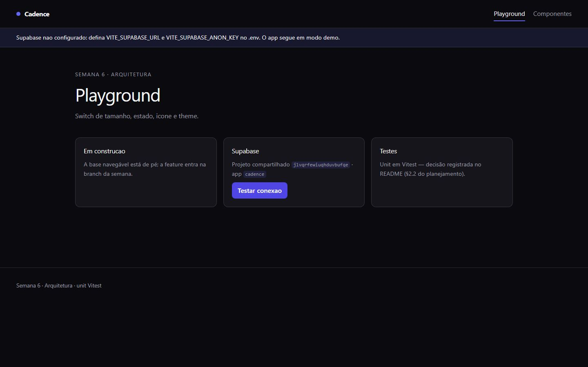
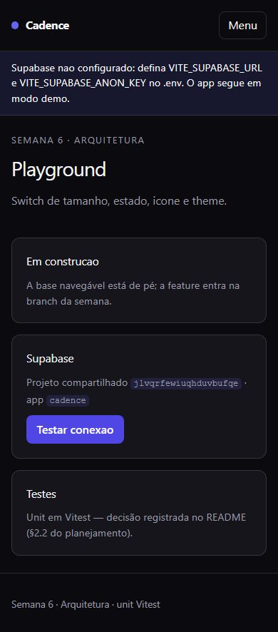
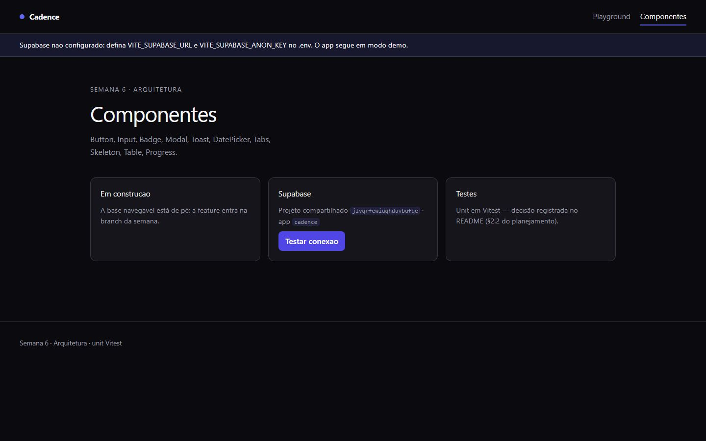
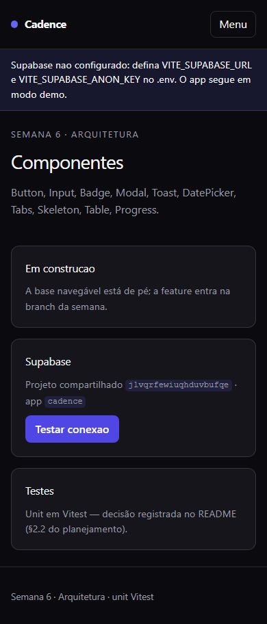

# Cadence — Design System Acessível


> **Design system acessível** — tokens, componentes e playground — consumido pelos
> outros projetos do roadmap. Pilar **Arquitetura** · Semana 6 · Milestone
> `m1-cadence` · Demo pública no GitHub Pages.

---

## Screenshots do Produto

### Playground
| Desktop | Mobile |
|---------|--------|
|  |  |

### Componentes
| Desktop | Mobile |
|---------|--------|
|  |  |

> **Baselines:** 4 screenshots (2 rotas × desktop/mobile) versionadas em
> `docs/screenshots/`, geradas por `e2e/screenshots.spec.ts` (Playwright).
> Regerar com `npm run e2e:screenshots`.

---

## Documentação

| Arquivo | Descrição |
|---------|-----------|
| [`docs/cadence-case.md`](./docs/cadence-case.md) | Case study: contexto, desafio, solução, métricas e "o que aprendi" |
| [`docs/a11y/relatorio-axe.json`](./docs/a11y/relatorio-axe.json) | Relatório de acessibilidade (axe) das 2 rotas |
| [`docs/clarity-integracao.md`](./docs/clarity-integracao.md) | Integração do Microsoft Clarity (mapa de calor) |
| [`docs/manter-online.md`](./docs/manter-online.md) | Estratégia zero-standby (custo zero) |

---

## Setup Rápido

```bash
npm install          # instala dependências; o postinstall roda `npm run env`
npm start            # ng serve → http://localhost:4200
```

O app funciona **sem backend**: quando `VITE_SUPABASE_ANON_KEY` não está definida,
ele sobe em **modo demo** e mostra um aviso na tela (`role="status"`). Isso mantém
os testes E2E determinísticos e a demo sempre online.

---

## Comandos Principais

| Comando | Descrição |
|---------|-----------|
| `npm start` | Servidor de desenvolvimento (`ng serve`) |
| `npm run build` | Build de produção (`ng build`) |
| `npm run lint` | ESLint + angular-eslint |
| `npm test` | Testes unitários (Vitest, watch) |
| `npm run test:ci` | Testes unitários + cobertura (CI) |
| `npm run e2e` | Playwright (axe + screenshots) |
| `npm run e2e:a11y` | Varredura de acessibilidade (gera relatório axe) |
| `npm run e2e:screenshots` | Regenera os prints do README |

---

## Telas Implementadas

| Tela | Rota | Conteúdo |
|------|------|----------|
| Playground | `/playground` | Cartões com health-check do Supabase (botão "Testar conexão") e estado da base |
| Componentes | `/componentes` | Catálogo planejado: Button, Input, Badge, Modal, Toast, DatePicker, Tabs, Skeleton, Table, Progress |

> `/` redireciona para `/playground`; qualquer rota desconhecida também
> (`{ path: '**', redirectTo: 'playground' }`).

---

## Qualidade & Performance

| Métrica | Resultado |
|---------|-----------|
| **Unit tests (Vitest)** | 4/4 passando (3 arquivos) |
| **Cobertura** | 75,25% statements · 71,18% branches · 76,61% lines |
| **E2E (Playwright)** | 5/5 passando (axe + screenshots) |
| **Acessibilidade (axe)** | 0 violações graves/críticas nas 2 rotas |
| **Lighthouse** | Performance **99** · A11y **100** · Best Practices **100** · SEO **100** |
| **ESLint** | 0 erros |
| **Bundle inicial** | 466 kB (≈115 kB transfer) |
| **Responsivo** | mobile (390) / desktop (1440) |

> Lighthouse medido com `npx @lhci/cli autorun` sobre o build estático
> (`lighthouserc.json`). O build traz um **aviso** pré-existente de budget
> (466 kB > 350 kB) por causa do `@supabase/supabase-js` no bundle inicial —
> não é erro e o budget de erro (500 kB) segue respeitado.

---

## Acessibilidade

Varredura automatizada com `@axe-core/playwright` (tags WCAG 2.0/2.1 A+AA) nas
duas rotas — **zero violações** graves ou críticas.

- **Tokens com contraste AA:** o acento de marca (`--acento: #6366f1`) serve foco e
  realce; preenchimentos sólidos usam `--acento-forte: #4f46e5`, que aceita texto
  branco em AA (≥ 4.5:1). Separar os dois tokens foi o que zerou o `color-contrast`.
- **Shell semântico:** link "Pular para o conteúdo", `aria-expanded`/`aria-controls`
  no botão de menu, `<main id="conteudo">` e foco visível no acento.
- **Movimento respeitado:** `@media (prefers-reduced-motion: reduce)` zera
  animações e transições.
- Relatório versionado em [`docs/a11y/relatorio-axe.json`](./docs/a11y/relatorio-axe.json).
  Reproduzir: `npm run e2e:a11y`.

---

## Design — decisão e intenção

> Cada escolha abaixo tem um "para quê" — nada é decorativo solto.

### Conceito

**Cadence** é a base de design do roadmap: um sistema escuro, sóbrio e tipográfico
que empresta identidade visual e regras de acessibilidade para os outros apps. A
palavra "cadence" é o **ritmo** — a ideia de que componentes compartilhados dão
cadência (consistência) ao portfólio.

### Identidade visual

| Token | Valor | Para quê |
|-------|-------|----------|
| `--fundo` | `#0b0b0f` | Palco quase preto — fundo padrão do sistema |
| `--superficie` | `#15151b` | Cartões e superfícies elevadas (1 nível acima do fundo) |
| `--texto` | `#f5f5f7` | Texto principal em contraste alto sobre o escuro |
| `--tenue` | `#9a9aa5` | Texto secundário/etiquetas — hierarquia sem gritar |
| `--acento` | `#6366f1` | Ação/foco: outline, pontos e realces |
| `--acento-forte` | `#4f46e5` | Preenchimento sólido com texto branco (contraste AA) |
| `--borda` | `color-mix(#f5f5f7 14%)` | Divisórias que se adaptam ao tema via `color-mix` |

- **Tipografia:** `Inter` (com fallback `system-ui`) para corpo e títulos —
  neutra, legível e sem custo de carregamento externo.
- **Formas e consistência:** cartões `rounded-0.75rem` sobre `--superficie` com
  borda sutil; foco sempre visível (`outline: 2px` no acento).
- **Nomes em pt-BR:** classes e variáveis em português (`.cartao`, `.acao`,
  `.rodape`), reforçando o ambiente de trabalho em português brasileiro.

### Estratégia de acessibilidade

| Peça | Implementação | Intenção |
|------|---------------|----------|
| Tokens | Dois tons de acento (realce vs preenchimento) | Garantir contraste AA sem sacrificar a marca |
| Skip link | `.pular-para-conteudo` visível no foco | Pular a navegação para quem usa teclado |
| Menu | `aria-expanded` + `aria-controls` | Anunciar estado do menu para leitores de tela |
| Estado | `role="status"` no aviso e nos resultados | Feedback anunciado sem roubar o foco |
| Movimento | `prefers-reduced-motion` | Respeitar quem pediu menos animação |

### Trade-off consciente

O bundle inicial carrega `@supabase/supabase-js` inteiro (~466 kB), acima do
budget de aviso de 350 kB. Para um design system a ganho de code-splitting ainda
não compensa a complexidade — o budget de erro (500 kB) segue respeitado e a meta
de performance do roadmap cuida disso depois.

---

## Dados e conteúdo (sem backend próprio)

- **Supabase (projeto compartilhado):** Postgres + Auth + RLS, slug `cadence`.
  O health-check do playground chama `auth.getSession()` e mostra o resultado.
- **Modo demo:** sem `VITE_SUPABASE_ANON_KEY` o app não cria cliente e exibe o
  aviso — o E2E roda sem rede/credenciais.
- A `service_role` key **nunca** entra no front; a proteção real é o RLS.

Ambiente (`.env`, nunca commitado):

```
VITE_SUPABASE_URL=
VITE_SUPABASE_ANON_KEY=
VITE_SUPABASE_PROJECT_SLUG=cadence
VITE_ROLE=demo
```

---

## Decisão de teste: Vitest

> Cada repo do roadmap alterna Karma/Vitest de propósito: agnóstico de ferramenta, escolha por contexto.

Neste repo o contexto é um **design system** com pouca lógica e muito template:

- **Nativo ESM + TypeScript:** o Vitest transforma os specs no mesmo pipeline do `ng build`.
- **CI sem browser:** roda em Node puro, mais rápido e estável que o Karma (que o Angular já deprecia).
- **Watch mode instantâneo:** feedback imediato ao iterar em componentes/tokens.
- **Cobertura V8 embutida:** cobertura/lcov nativos, sem plugin extra.

---

## Estrutura do Projeto

```text
src/
├─ app/
│  ├─ core/                 # config (leitura do ambiente) e SupabaseService
│  ├─ pages/                # playground e componentes (lazy por rota)
│  ├─ app.ts / app.html     # shell: header, nav, skip-link, footer
│  └─ app.routes.ts         # rotas ('' → /playground, '**' → /playground)
├─ environments/            # ambiente.local.ts (gerado, gitignored)
└─ styles.css               # tokens do design system + Tailwind 4
e2e/                        # Playwright: acessibilidade (axe) e screenshots
docs/                       # case study, a11y, screenshots, runbooks
.github/workflows/          # CI (lint→build→unit→e2e→lighthouse) + Deploy (GitHub Pages)
```

---

## Stack

| Responsabilidade | Tecnologia |
|------------------|------------|
| Framework | Angular 22 (standalone, signals, templates com control flow) |
| Linguagem | TypeScript |
| Estilização | Tailwind CSS 4 + tokens em CSS custom properties |
| Backend/Dados | Supabase (Postgres + Auth + RLS) com modo demo |
| Testes | Vitest (unit) · Playwright + axe (E2E/a11y) |
| Qualidade | ESLint + angular-eslint · Lighthouse CI |
| Deploy | GitHub Pages (site estático) |

---

## Branches & Workflow Git

```text
main      → produção (build estático; push dispara deploy no GitHub Pages)
homolog   → validação/release de PRs (staging)
develop   → integração diária (merges das feat/*)
feature   → feat/<assunto> + PR para develop
```

- **Commits:** `feat:`, `fix:`, `test:`, `docs:`, `design:`, `ops:`, `backend:` (Conventional Commits)
- **PRs:** via pull request template; revisados e mergeados por milestone
- **main:** protegida — merge somente via PR
- Rastreabilidade com issues, labels (`feat/test/design/ops/backend`) e milestones

---

## Bots (estação local + CI)

Os bots vivem em `bots/` e rodam localmente e no GitHub Actions.

| Bot | O que faz | Como roda localmente |
|-----|-----------|----------------------|
| **Testes** (`.github/workflows/bot-testes.yaml`) | Agenda a suíte completa (lint → build → unit → e2e) e guarda evidências. | `npm run lint && npm run test:ci && npm run e2e` |
| **Humano** (`bots/humano/navegacao-humana.mjs`) | Navega com comportamento de pessoa real (cliques com atraso, scroll gradual). | `BOT_URL=http://localhost:4200 node bots/humano/navegacao-humana.mjs` |
| **Analisador de erros** (`bots/analise-erros/analisador.mjs`) | Lê logs de build/e2e/CI, classifica por severidade e aponta padrões. | `node bots/analise-erros/analisador.mjs` |

---

## Microsoft Clarity (mapa de calor)

Integração **condicional**: o snippet só é ativado quando `CLARITY_PROJECT_ID`
estiver definido. Ver [`docs/clarity-integracao.md`](./docs/clarity-integracao.md).

---

## Deploy

- **GitHub Pages** (projeto público): `https://zecki1.github.io/angular-cadence/`
  Workflow [`.github/workflows/deploy-pages.yaml`](./.github/workflows/deploy-pages.yaml)
  — build com `--base-href=/angular-cadence/` + fallback SPA (`index.html` → `404.html`).
- **Política do workspace:** projetos públicos → GitHub Pages; projetos privados → Vercel
  (config em `vercel.json`).
- Estratégia zero-standby documentada em [`docs/manter-online.md`](./docs/manter-online.md).

---

## Links Úteis

- **Produção (GitHub Pages):** https://zecki1.github.io/angular-cadence/
- **Repositório:** https://github.com/zecki1/angular-cadence

---

## Licença

MIT — ver [`LICENSE`](./LICENSE).
